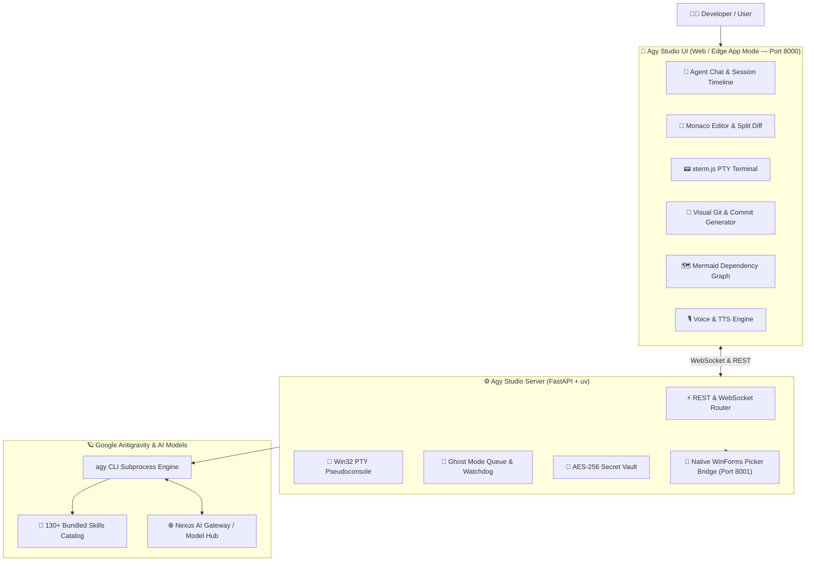

<div align="center">

# ⚡ Agy Studio

**The Ultimate Native Autonomous IDE, Workspace Control Plane & UI for Google Antigravity (`agy`)**

*Harness full agentic superpowers on Windows 11 with Monaco Editor, Real-Time xterm.js PTY Terminal, Visual Git Control, Ghost Mode Autonomous Queue, and 130+ bundled agent skills.*

[](LICENSE)
[](https://microsoft.com)
[-DE5FE9?logo=python&logoColor=white)](https://astral.sh/uv)
[](https://fastapi.tiangolo.com)
[](https://microsoft.github.io/monaco-editor/)
[](https://xtermjs.org)
[](skills/)

[Key Features](#-key-features) • [Quickstart](#-quickstart-in-30-seconds) • [Architecture](#-architecture) • [Module Tour](#-module-tour) • [Bundled Skills](#-130-bundled-agentic-skills) • [Troubleshooting](#-troubleshooting)

</div>

---

## 🌟 Why Agy Studio?

**Agy Studio** bridges the gap between terminal-based CLI agents and modern developer ergonomics. While Google Antigravity CLI (`agy`) delivers extraordinary coding and multi-turn autonomous capabilities, developers need:

1. **Visual Context & Instant Verification**: Inspect files, syntax-highlighted code diffs, and live renders side-by-side.
2. **Interactive Terminal Control**: An integrated bidirectional PowerShell terminal (xterm.js) embedded right beneath your conversation.
3. **Seamless Git Lifecycle**: AI-generated conventional commits (`feat: ...`, `fix: ...`), branch graphs, and 1-click push/pull without leaving the canvas.
4. **Autonomous Background Workers**: Run multi-hour background queues (Ghost Mode) without locking your workstation.
5. **Zero-Install Portability**: Powered by self-contained Astral `uv.exe` and native C# launcher binaries—runs on any clean Windows 11 machine in seconds.

---

## 🚀 Key Features

| Capability | What It Delivers |
|---|---|
| 🖥️ **Monaco Editor & Split-Diff** | Full VS Code editor core with syntax highlighting, line minimap, `Ctrl+F` search, and side-by-side agent diff inspection. |
| ⚡ **Live Web PTY Terminal** | Embedded real-time PowerShell terminal powered by `xterm.js` and WebSockets. Toggle instantly with `Ctrl+\``. |
| 🐙 **Visual Git & GitHub GUI** | Stage, unstage, view git graphs, inspect changed files, and generate conventional commit messages via AI. |
| 👻 **Autonomous Ghost Mode** | Persistent task queue engine with WinRT native Windows 11 toast notifications upon task completion. |
| 🗺️ **Project Dependency Graph** | Real-time AST & regex dependency analyzer with interactive Mermaid graph visualization. |
| 🔐 **Secure .env Vault** | Encrypted key storage for Gemini, OpenAI, Anthropic, Cloudflare, and custom model providers with automatic masking. |
| 🎙️ **Voice-to-Prompt & TTS** | Speech-to-text input via Web Speech API and spoken agent response playback. |
| ☁️ **1-Click Cloud Deployment** | Instant publish to Cloudflare Pages, Vercel, and Clean Distribution ZIP creation. |
| 🎒 **130+ Pre-Configured Skills** | Instantly accessible skills including document automation, UI design systems, VPS management, and code auditing. |

---

## ⚡ Quickstart in 30 Seconds

### Prerequisites
- **Windows 11 (x64)**
- **Google Antigravity CLI (`agy`)** installed on your system

> 💡 *No Python or Node.js pre-installation needed! The embedded `runtime/uv.exe` engine manages all dependencies dynamically in isolated environments.*

### 1. Launch in One Click
Double click:
```text
AgyStudio.exe
```
*(Or run `start-studio.bat` / `start-studio.ps1` from terminal)*

The launcher will:
- Check and release ports `8000` (FastAPI) and `8001` (Win32 Folder Picker Bridge).
- Launch the backend with optimal FastAPI worker threads.
- Open Agy Studio in dedicated Chrome/Edge app window mode at `http://127.0.0.1:8000`.

### 2. Initial Setup on a Fresh Machine
If deploying to a fresh PC or external drive, run:
```bat
setup-portable.bat
```
This automatically registers the 130+ bundled agent skills into `~/.gemini/config/skills.json` and creates a desktop shortcut.

---

## 🏗️ Architecture



---

## 📁 Repository Structure

```text
Agy Studio/
├── AgyStudio.exe                 # ⚡ Ultra-fast native C# launcher (production binary)
├── AgyStudioConsole.exe          # 🔍 Debug launcher with live console diagnostics
├── AgyStudioFolderPicker.exe     # 📁 Native Win32/WinForms folder dialogue bridge
├── start-studio.bat              # 🚀 Terminal launcher batch script
├── start-studio.ps1              # 💙 Native PowerShell launcher script
├── setup-portable.bat            # 🛠️ 1-click global skills & registry setup
├── launcher.cs                   # 📜 C# source code for the high-performance launcher
├── README_PORTABLE.md            # 🇫🇷 French deployment guide for offline labs
├── runtime/
│   └── uv.exe                    # 🐍 Self-contained Astral UV runtime
├── backend/                      # ⚙️ FastAPI asynchronous backend & agent adapters
├── static/                       # 🎨 Modern Tailwind UI & Monaco/xterm frontend assets
├── skills/                       # 🧠 130+ production agent skills (YAML frontmatter + SKILL.md)
├── scripts/                      # 🛠️ Verification, linting, and healthcheck utilities
└── data/                         # 💾 Persistent workspaces, session logs, and cache
```

---

## 🧠 130+ Bundled Agentic Skills

Agy Studio comes out of the box with an extensive skills library ready to be leveraged by `agy`:

- **Document Engineering**: `cahierdetext` (strict cantSplit ATAM automated tracking sheets), `kimi-docx`, `kimi-pdf`, `kimi-xlsx`, `powerpoint`.
- **UI & Frontend**: `frontend-design`, `ui-ux-pro-max`, `popular-web-designs`, `p5js`, `ascii-art`.
- **Infrastructure & Cloud**: `vps-manager`, `network-engineer`, `wordpress-pro`, `blacksmith-testbox`.
- **Autonomous Agent Systems**: `agent-autonomy-kit`, `agent-memory`, `kanban-orchestrator`, `subagent-driven-development`.
- **Scientific & Biology**: `chembl-database`, `clinvar-database`, `uniprot-database`, `foldseek-structural-search`, `ensembl-database`.
- **Reverse Engineering & QA**: `systematic-debugging`, `codebase-inspection`, `dogfood`, `test-driven-development`.

---

## 🏷️ Keywords & Search Tags

`google-antigravity` · `antigravity-studio` · `agy-cli` · `ai-ide` · `autonomous-coding-agent` · `monaco-editor` · `xterm-js` · `fastapi` · `astral-uv` · `gemini-3` · `deepseek-r1` · `claude-code` · `coding-copilot` · `windows-11-ai` · `developer-tools`

---

## 🛡️ License

Distributed under the **MIT License**. See `LICENSE` for details.
